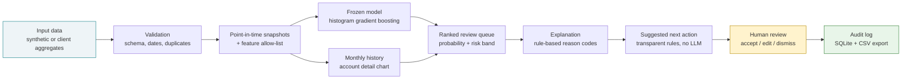
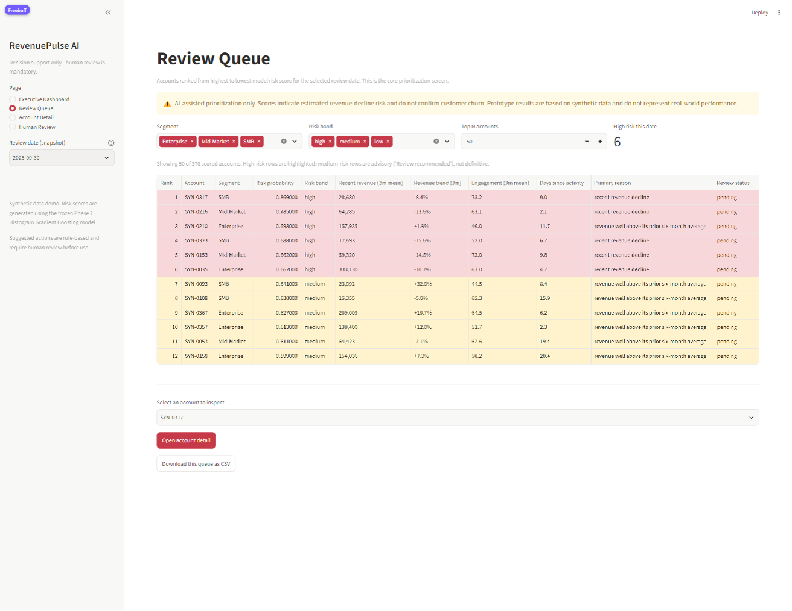

# RevenuePulse AI

**AI-assisted account prioritization for revenue-risk review - a decision-support
copilot for B2B sales teams.**

RevenuePulse AI ranks accounts by the likelihood of a material revenue decline in the
next 90 days, explains the score with checkable evidence, suggests a next-best action,
and records the human decision. It never contacts a customer, changes a price or writes
to a CRM.

> **SYNTHETIC DATA - NOT REAL-WORLD PERFORMANCE.** Every account history and every
> metric in this repository is generated. The evaluation demonstrates that the method
> works on this synthetic dataset; it does not establish real-world churn or revenue
> prediction performance.

**Capstone:** MBA ZG583 · individual submission · Suhani Kanwar
**Recommendation:** Iterate toward a controlled real-data paid pilot. Do not scale.

---

## Problem

A B2B sales manager owns 150-400 recurring-revenue accounts and can review perhaps 50
per quarter. Account history is fragmented across billing, CRM and product tools.
Dashboards show the past and do not rank the future, so review effort follows recency
and familiarity, and a material decline is often noticed only when it appears in
revenue reporting - after the intervention window has narrowed.

## Solution

A quarterly review queue that answers three questions per account:

1. **How likely is a material revenue decline?** A calibrated model probability, with
   high / medium / low risk bands from configured thresholds.
2. **Why?** Rule-based reason codes over the account's own features ("factors
   associated with the risk score include ..."), not LLM prose.
3. **What next?** A transparent, evidence-linked next-best-action suggestion that a
   human must accept, edit or dismiss.

Every decision is written to a local audit log with timestamp, score, AI suggestion,
decision, edited text and reviewer note.

**Boundary:** decision support only. No automated customer contact, pricing, offers,
emails, CRM actions or autonomous commercial decisions. Human approval is mandatory.

## Why AI

| Approach | What it gives | Limit |
|---|---|---|
| Dashboard | History and filters | No ordering against a future outcome |
| Hand-written rule | Transparent and cheap | Encodes existing beliefs; misses interactions |
| Learned model | Combined signal, calibrated ordering | Needs data discipline, monitoring, explanation |
| LLM narrative | Fluent text | No ranking guarantee, hallucination risk, cost |

At the 50-account capacity the product assumes, the learned model found 27 future
decliners in the queue versus 7 for a transparent four-signal scorecard on the same
locked synthetic test split.

## Architecture



Reproducible pipeline:

```text
config.yaml
  -> synthetic generator (src/data)
  -> validation + quality checks
  -> quarter-end snapshots, features, label, splits (src/features)
  -> baseline + logistic regression + gradient boosting (src/models)
  -> locked test evaluation, calibration, bootstrap (src/evaluation)
  -> artifact + metadata (artifacts/model)
  -> review queue, reasons, recommendations, audit log (src/product, prototype)
```

## Model Results

**SYNTHETIC DATA - NOT REAL-WORLD PERFORMANCE.**

Locked test split: 748 snapshot rows, 380 accounts, 94 positives, 12.6% prevalence.
Selection used train/validation only; the test split was scored once.

| Model | P@10 | P@25 | P@50 | Recall@50 | Lift@50 | False alarm@50 | PR-AUC | ROC-AUC | Brier |
|---|---|---|---|---|---|---|---|---|---|
| Transparent scorecard | 0.200 | 0.200 | 0.140 | 0.074 | 1.11 | 0.860 | 0.136 | 0.540 | 0.243 |
| Logistic regression | 0.500 | 0.560 | 0.480 | 0.255 | 3.82 | 0.520 | 0.350 | 0.781 | 0.097 |
| Histogram gradient boosting (selected) | 0.600 | 0.720 | 0.540 | 0.287 | 4.30 | 0.460 | 0.382 | 0.756 | 0.094 |

- HGB Precision@50 **0.540**, account-level bootstrap 95% CI **[0.400, 0.700]**.
- HGB minus scorecard Precision@50 **+0.400**, CI **[+0.240, +0.560]**.
- Calibration acceptable without a fitted calibrator (Brier 0.094, mean bin gap 0.030).
- Recall@50 0.287: most future decliners are outside a 50-account queue.

**Interpretation limits:** the dominant learned driver is a *positive* six-month revenue
trend, which precedes give-back in this generator and contradicts normal churn
intuition. The rule baseline is weak on this data. Both facts are disclosed in
[`docs/Model_Card.md`](docs/Model_Card.md) and
[`docs/Evaluation_Results.md`](docs/Evaluation_Results.md).

## Prototype

A four-page Streamlit application using the frozen model artifact:

1. **Executive Dashboard** - accounts reviewed, high/medium/low counts, model in use,
   risk distribution chart, disclaimer.
2. **Review Queue** - ranked accounts with risk probability and band, recent revenue,
   revenue trend, engagement, activity recency, primary reason and review status;
   filters by segment, band and top N; high-risk highlighting; CSV export.
3. **Account Detail** - probability, band, monthly revenue chart, commercial signals,
   reason codes and a rule-based next-best-action with evidence.
4. **Human Review** - accept / edit / dismiss with optional note; SQLite audit log at
   `runtime/review_feedback.db`; CSV export.

No authentication, no CRM integration, no LLM, no automated action. See
[`prototype/README.md`](prototype/README.md).

Captured screens of all four pages, the reason codes and the audit log are in
[`screenshots/`](screenshots/).



## Demo Workflow

1. Launch the app and open **Review Queue**.
2. Select the review date (quarter-end snapshot, e.g. 2025-09-30).
3. Filter to a segment and risk band, then choose the top N accounts.
4. Select an account and open **Account Detail** to review the evidence and reasons.
5. Read the suggested action, then go to **Human Review** and accept, edit or dismiss.
6. Confirm the decision appears in the review log and export it to CSV.

## Repository Structure

```text
RevenuePulse_AI/
├── README.md                     # this landing page
├── AGENTS.md                     # operating rules for coding agents
├── config.yaml                   # all material assumptions
├── requirements.txt
├── pytest.ini
│
├── data/
│   ├── sample/                   # committed 60-account demo CSV
│   ├── processed/                # regenerated, git-ignored
│   └── README.md
│
├── src/
│   ├── data/                     # schema, quality, synthetic generator
│   ├── features/                 # snapshots, feature allow-list, label, splits
│   ├── models/                   # baseline, preprocessing, training, reasons
│   ├── evaluation/               # metrics, bootstrap, locked evaluation
│   ├── product/                  # queue, recommendations, feedback store
│   └── utils/                    # configuration
│
├── prototype/                    # Streamlit app (4 pages)
├── artifacts/                    # model + evaluation outputs (git-ignored, reproducible)
├── tests/                        # Phase 1, Phase 2 and product suites
├── docs/                         # data dictionary, build notes, model card, evaluation
├── submission/                   # final MBA submission artifacts
├── presentation/                 # 11-slide deck (Markdown + PPTX)
├── screenshots/                  # prototype captures for the appendix
├── diagrams/                     # PlantUML workflows (+ rendered PNGs)
├── runtime/                      # local review log (git-ignored)
└── submission/README.md          # requirement-to-file index
```

## Setup

Requires **Python 3.12**.

```powershell
cd RevenuePulse_AI
python -m venv .venv
.\.venv\Scripts\Activate.ps1
python -m pip install --upgrade pip
python -m pip install -r requirements.txt
```

On macOS/Linux use `python3.12 -m venv .venv` and `source .venv/bin/activate`.
If PowerShell blocks activation, call the interpreter directly:
`.\.venv\Scripts\python.exe -m pytest`.

## Run

Full pipeline from a clean checkout, in order:

```powershell
# 1. Synthetic data (400 accounts x 36 months)
.\.venv\Scripts\python.exe -m src.data.generate_synthetic

# 2. Point-in-time snapshots
.\.venv\Scripts\python.exe -m src.features.build_snapshots `
  --input data/processed/account_month_full.csv `
  --output data/processed/snapshots_full.csv

# 3. Train candidates, compare on validation, freeze the model
.\.venv\Scripts\python.exe -m src.models.train

# 4. Single locked test evaluation (writes artifacts/evaluation)
.\.venv\Scripts\python.exe -m src.evaluation.evaluate

# 5. Streamlit prototype
.\.venv\Scripts\python.exe -m streamlit run prototype/app.py
```

The app opens at `http://localhost:8501`. If the model or snapshots are missing it shows
a controlled error with the command to rebuild them.

Small committed demo dataset (60 accounts):

```powershell
.\.venv\Scripts\python.exe -m src.data.generate_synthetic --demo
.\.venv\Scripts\python.exe -m src.features.build_snapshots `
  --input data/sample/account_month_sample.csv `
  --output data/processed/snapshots_sample.csv
```

Command reference (all with an activated virtual environment, so `python` is the
project interpreter):

| Stage | Command |
|---|---|
| Regenerate data | `python -m src.data.generate_synthetic` |
| Validate data | `python -m src.data.validate_data --input data/sample/account_month_sample.csv` |
| Rebuild snapshots | `python -m src.features.build_snapshots --input data/processed/account_month_full.csv --output data/processed/snapshots_full.csv` |
| Train and freeze | `python -m src.models.train` |
| Locked evaluation | `python -m src.evaluation.evaluate` |
| Prototype | `python -m streamlit run prototype/app.py` |
| Tests | `python -m pytest` |

Model artifact: `artifacts/model/revenuepulse_model.joblib` plus
`artifacts/model/model_metadata.json` (feature list, label definition, train/validation/
test periods, seed, parameters, selected metrics, synthetic flag, version, environment).
Evaluation outputs: `artifacts/evaluation/`.

## Testing

```powershell
.\.venv\Scripts\python.exe -m pytest
```

132 tests cover configuration guardrails, synthetic generation, data quality, label and
split correctness, leakage (future-revenue mutation), train-only preprocessing, metric
arithmetic including Precision@K, account-level bootstrap, validation-only selection,
artifact reload and reproducibility, reason-code integrity, product-layer ranking and
fallbacks, SQLite feedback and CSV export, guardrails against outbound integrations, and
a Streamlit import/AppTest smoke check.

Optional deck regeneration: `python presentation/build_presentation.py` (requires
`python-pptx`, already in `requirements.txt`).

## PM / Submission Artifacts

| Requirement | File |
|---|---|
| Submission index | [`submission/README.md`](submission/README.md) |
| Executive summary | [`submission/01_Executive_Summary.md`](submission/01_Executive_Summary.md) |
| Final report | [`submission/02_Final_Report.md`](submission/02_Final_Report.md) |
| PM artifact pack (PRD) | [`submission/03_PM_Artifact_Pack.md`](submission/03_PM_Artifact_Pack.md) |
| Prototype readme / link | [`submission/04_Prototype_Readme_or_Link.md`](submission/04_Prototype_Readme_or_Link.md) |
| Ethics, governance, risk | [`submission/04_Ethics_Governance_Risk.md`](submission/04_Ethics_Governance_Risk.md) |
| AI collaboration log | [`submission/05_AI_Collaboration_Log.md`](submission/05_AI_Collaboration_Log.md) |
| AI self-evaluation | [`submission/06_AI_Self_Evaluation.md`](submission/06_AI_Self_Evaluation.md) |
| Individual contribution | [`submission/07_Individual_Contribution_Statement.md`](submission/07_Individual_Contribution_Statement.md) |
| Presentation (11 slides) | [`presentation/Final_Presentation.md`](presentation/Final_Presentation.md) · `RevenuePulse_AI_Final_Presentation.pptx` |
| Workflow diagrams | [`diagrams/`](diagrams/) (`.puml` + `.png`) |
| Prototype screenshots | [`screenshots/`](screenshots/) |
| Model card | [`docs/Model_Card.md`](docs/Model_Card.md) |
| Evaluation results | [`docs/Evaluation_Results.md`](docs/Evaluation_Results.md) |
| Error analysis | [`docs/Error_Analysis.md`](docs/Error_Analysis.md) |
| Build notes | [`docs/Phase_1_Build_Notes.md`](docs/Phase_1_Build_Notes.md) · [`docs/Phase_2_Build_Notes.md`](docs/Phase_2_Build_Notes.md) |
| Data dictionary | [`docs/Data_Dictionary.md`](docs/Data_Dictionary.md) |

## Limitations

- **Synthetic only.** No real-world performance, willingness to pay or retention impact
  is established. The generator's growth-to-give-back pattern may not exist in reality.
- **Proxy label.** A 20% three-month revenue drop, not cancellation or churn.
- **Weak baseline.** The four-signal scorecard is near random here; a stronger simple
  rule could close much of the gap.
- **Recall at capacity.** Recall@50 is 0.287, so most decliners are outside the queue.
- **Small evaluation.** Two test quarter-ends, 94 positives; Precision@50 CI ±0.14.
- **No human evidence.** No acceptance rate, time saving or intervention effect has been
  measured; these are pilot metrics.
- **Prototype, not product.** No authentication, roles, monitoring, drift detection or
  deployment hardening.
- **Business numbers are hypotheses.** Pricing, hours, hosting and margin assumptions
  are editable placeholders; CAC is unknown and LTV/CAC is deliberately not computed.

## Commercial Pilot

| Phase | Scope | Duration | Price |
|---|---|---|---|
| 0 - Diagnostic sprint | Data audit, workflow discovery, baseline feasibility | 12-16 hours | ₹50k-₹75k |
| 1 - Paid pilot | One segment, controlled account-risk prioritisation | 6-8 weeks | ₹1.5L-₹2.5L |
| 2 - Productised SaaS | Auth, roles, monitoring, standard onboarding | Post-pilot | Subscription / enterprise licence |
| 3 - Scale | CRM integration, multi-user, multi-tenancy | Later | Enterprise tiers |

Pilot terms: fixed fee, 50% upfront, 50% at readout, two-week termination for
convenience, no automatic renewal, no success fee. Data: account IDs and monthly
aggregates only, no names or emails, encrypted transfer, deleted after 30 days, no LLM
by default. Success criteria are agreed before the start: triage time, reviewer
acceptance, Precision@K versus the client's rule, false-alarm tolerance and at least one
documented intervention. No product-market fit is claimed.

## Responsible AI

Decision support only; human review is mandatory on every account. No automated
customer contact, pricing change, offer, email or CRM action exists in the code, and a
test asserts no outbound integration is present. All data is synthetic and contains no
personal identifiers. Prohibited uses, monitoring requirements and stop conditions are in
[`docs/Model_Card.md`](docs/Model_Card.md) and
[`submission/04_Ethics_Governance_Risk.md`](submission/04_Ethics_Governance_Risk.md).
Known gaps for a real pilot: authentication, role-based access, drift monitoring, a
deletion policy and a fairness review.

## Individual Contributor

**Suhani Kanwar** - product strategy, requirements, UX, data/model design, prototype,
business model, risk and governance, final review.

AI tools assisted with planning, drafting, coding and review; final judgement,
verification and submission responsibility remained with the student.

**GitHub ID:** [ADD BEFORE SUBMISSION]
