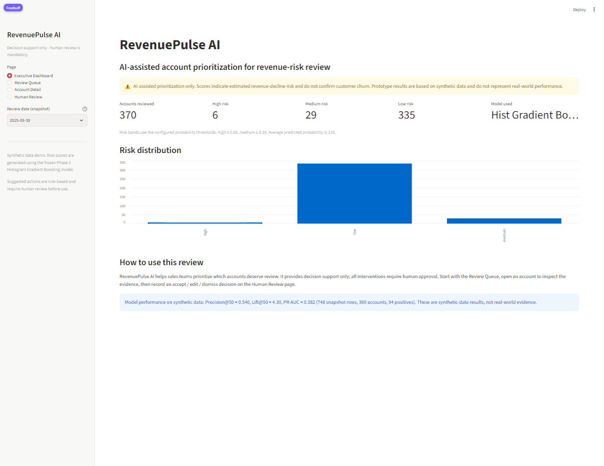
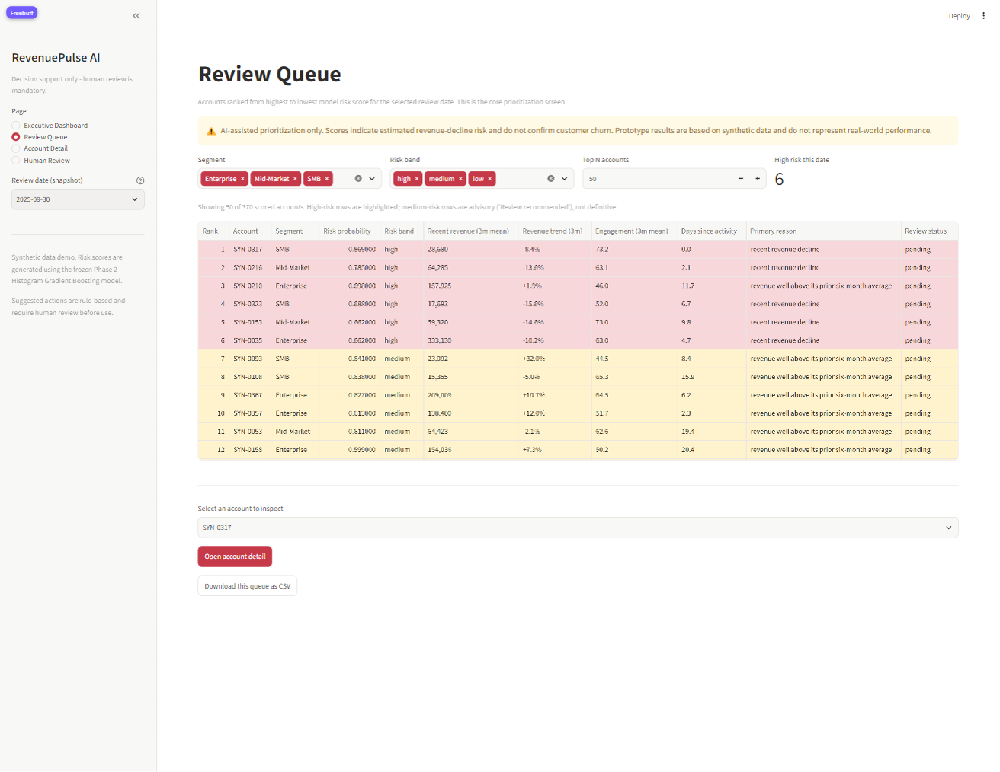
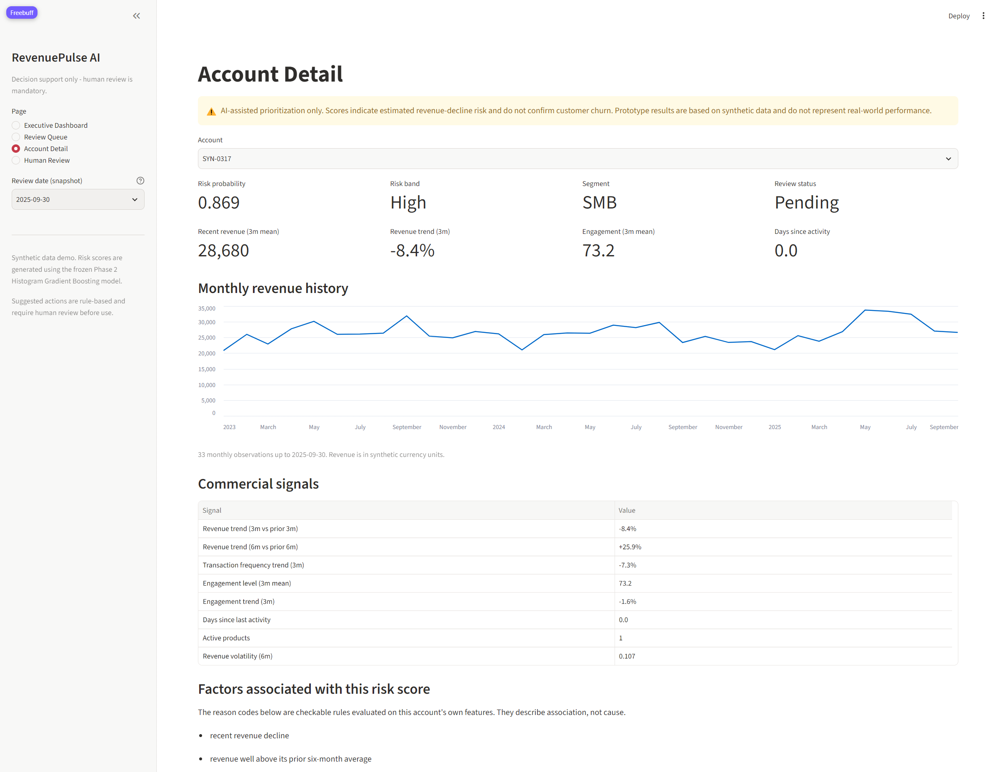
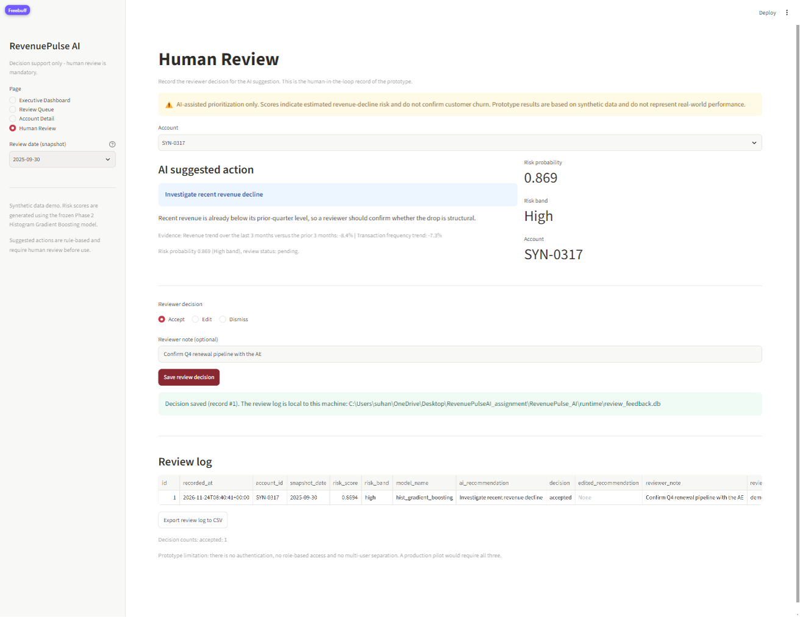

# RevenuePulse AI - Prototype Readme or Link

## Prototype Type

Streamlit web application (`prototype/app.py`), running locally against the frozen
Phase 2 model artifact. Four pages: Executive Dashboard, Review Queue, Account
Detail, Human Review.

## What It Demonstrates

- **Account prioritisation** - a ranked, filterable queue for a selected quarter-end
  snapshot, driven by the trained model rather than hardcoded scores.
- **ML risk prediction** - histogram gradient boosting probabilities in [0, 1], with
  configured high / medium / low bands.
- **Explanations** - rule-based reason codes derived from each account's own
  features, worded as associations, not causes.
- **Evidence-linked recommendation** - a deterministic next-best-action (no LLM) that
  cites the account values that triggered it.
- **Human review** - mandatory accept / edit / dismiss with optional reviewer note.
- **Feedback audit** - every decision stored in a local SQLite log
  (`runtime/review_feedback.db`) with timestamp, account, snapshot date, risk score,
  AI recommendation, decision, edited recommendation and note; exportable to CSV.

## What It Does Not Prove

- real-world accuracy (all evidence is synthetic);
- production scale or performance under load;
- CRM integration (none exists);
- customer retention impact (no intervention has been run);
- real-world economics (pricing and time savings are hypotheses);
- production privacy/security (no authentication, no roles, no deployment hardening).

## Repository

https://github.com/SK-Builds28/RevenuePulseAI

## Live Demo

Not deployed. Demo URL: none.

The prototype runs locally; the model metric artifact and review database stay on the
student's machine and are not hosted anywhere.

## Setup Instructions

From the `RevenuePulse_AI` directory (Windows; use `python3`/`source .venv/bin/activate`
on macOS/Linux):

```powershell
# 1. Virtual environment and dependencies
python -m venv .venv
.\.venv\Scripts\Activate.ps1
python -m pip install -r requirements.txt

# 2. Regenerate the synthetic data, snapshots and model if artifacts are absent
.\.venv\Scripts\python.exe -m src.data.generate_synthetic
.\.venv\Scripts\python.exe -m src.features.build_snapshots `
  --input data/processed/account_month_full.csv `
  --output data/processed/snapshots_full.csv
.\.venv\Scripts\python.exe -m src.models.train
.\.venv\Scripts\python.exe -m src.evaluation.evaluate

# 3. Launch the prototype
.\.venv\Scripts\python.exe -m streamlit run prototype/app.py
```

Open the printed local URL (default `http://localhost:8501`). The application needs
`data/processed/snapshots_full.csv` and `artifacts/model/revenuepulse_model.joblib`;
if either is missing it shows a controlled error with the command to rebuild it.

## Demo Steps

1. **Executive Dashboard** - confirm the synthetic-data warning, review counts
   (accounts reviewed, high / medium / low risk) and the model used.
2. **Review Queue** - keep the latest review date (2025-09-30), filter to Enterprise
   and high/medium bands, set top N to 25.
3. Note the ordering: risk probability descending, with recent revenue, revenue
   trend, engagement, days since activity, primary reason and review status.
4. **Open the top account** - inspect the probability, band, monthly revenue chart,
   commercial signals and "Factors associated with this risk score".
5. Read the **Next-best-action suggestion** and the evidence list behind it.
6. **Human Review** - choose Edit, replace the suggestion with a sharper action, add a
   note such as "Confirm Q4 renewal pipeline with the AE", and save.
7. Confirm the record appears in the review log and export it as CSV.
8. Try **Dismiss** on a medium-risk account with the note "known seasonal billing" to
   show that overrides are recorded.

## Screenshots

Captured from the running prototype at review date 2025-09-30 (see `screenshots/` at the
repository root). No data was edited for the captures; the review log contains the two
demo decisions described in the demo steps.

| File | Shows |
|---|---|
| `01_dashboard.png` | Executive dashboard: 370 accounts reviewed, 6 high / 29 medium / 335 low, model in use, synthetic-data disclaimer |
| `02_queue.png` | Ranked review queue with risk probability and band, revenue, trend, engagement, activity recency, primary reason and review status |
| `03_account_detail.png` | Account detail for the top-ranked account (SYN-0317): probability 0.869, High band, monthly revenue history |
| `03b_account_evidence.png` | Commercial signals, three reason codes and the rule-based next-best-action with its evidence |
| `04_human_review.png` | Human review: AI suggestion, Accept decision with reviewer note, saved confirmation and the review log |
| `05_review_log_export.png` | Dismiss decision on a medium-risk account, two-row audit log and CSV export control |









## Known Limitations of the Prototype

- No authentication, no role-based access, no multi-user separation.
- Single local SQLite file; no tamper-evidence or backup policy.
- No CRM integration by design; CSV is the only export.
- Screens are functional, not visually polished.
- All data is synthetic; the queue shows 370 accounts for the latest snapshot with
  6 high / 29 medium / 335 low at the configured thresholds.
- Model metric claims belong to `docs/Evaluation_Results.md`, not to this UI.
